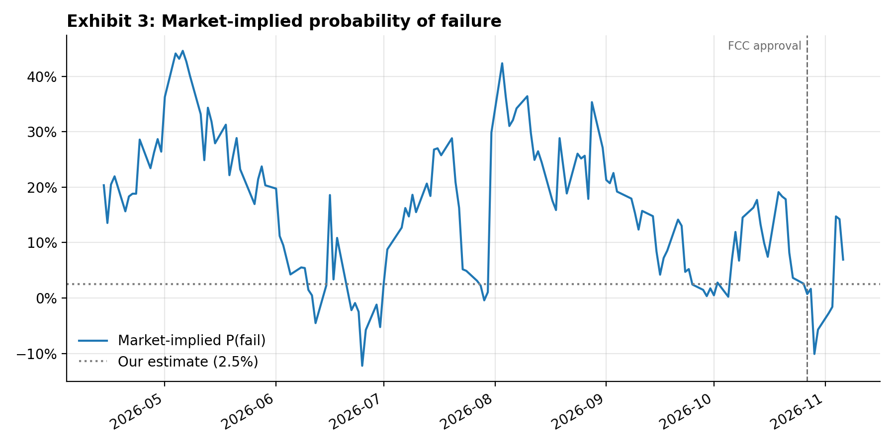
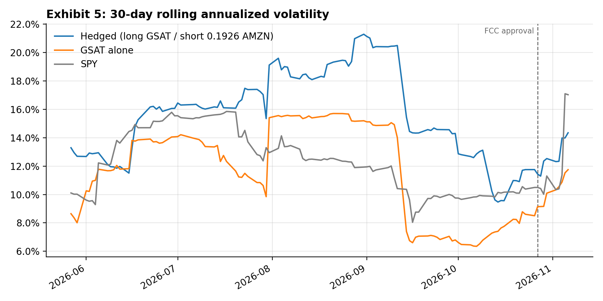

# Amazon-Globalstar Merger Arbitrage

Python version of my risk-arbitrage analysis of Amazon's cash-and-stock acquisition of Globalstar (announced April 13, 2026). Under the merger agreement, Globalstar shareholders can elect to receive $90.00 in cash or 0.3210 shares of Amazon common stock per GSAT share, with the stock consideration capped at $90.00 per share and aggregate cash elections capped at 40% of total shares through proration. The model incorporates both consideration components to calculate blended merger value.

It models a long GSAT / short AMZN position and computes blended consideration, gross and net spread, carry, downside if the deal breaks, market-implied probability of failure, and expected return, both for a single date and as a daily time series since announcement. It also measures the hedged position's risk (realized volatility, beta to the S&P 500, VaR/ES, and stress tests), updated for the October 2026 FCC approval.

## Quick start

```bash
python -m venv .venv && source .venv/bin/activate
pip install -r requirements.txt

python -m unittest                 # checks the engine against the report's numbers
python main.py                     # June 18, 2026 report snapshot + close-date scenarios
python main.py --history           # pull prices, build Exhibits 1–4 and output/report.md
python main.py --history --deal gsat_amzn_nov2026   # November-config exhibits (README images)
python main.py --compare           # June vs. November assumptions on the latest close
python main.py --risk --deal gsat_amzn_nov2026   # hedged-position risk, VaR/ES, stress tests, Exhibits 5–6
```

Other data sources: `--source bloomberg` (needs a Terminal session and `xbbg`) or `--csv prices.csv` (columns `date, p_target, p_acquirer`).

## Layout

```
merger_arb/
  config/deal_params.py   deal terms, scenarios, assumptions (the "input zone")
  data/prices.py          yfinance / Bloomberg / CSV loaders with a local cache
  models/                 formulas 1–7 and the engine that runs them
  models/position_risk.py realized vol, beta, drawdown, VaR/ES, stress tests of the hedged position
  viz/exhibits.py         Exhibits 1–6
  report/generate_report.py  Markdown summary
tests/test_models.py      reproduces every number in the written report
tests/test_nov2026.py     November 2026 config
tests/test_position_risk.py  risk module, on synthetic data
main.py                   CLI entry point
```

## Method

With C = prorated cash per share, E = prorated exchange ratio:

1. Consideration = C + E × P(AMZN)
2. Gross spread = (Consideration − P(GSAT)) / P(GSAT)
3. Annual carry = −r_f − E × (P(AMZN)/P(GSAT)) × (borrow fee − r_f)
4. Net spread = Gross + (days/365) × Carry
5. Downside = −[(P(GSAT,fail) − P(GSAT)) − E × (P(AMZN,fail) − P(AMZN))] / P(GSAT) − (14/365) × Carry
6. Implied P(fail) = Net / (Net + Downside)
7. Expected return = (1 − p) × Net − p × Downside

To analyze another deal, add a `DealInputs` entry in `config/deal_params.py` and register it in `DEALS`.


## Update: November 2026

The FCC approved the deal on October 27, 2026, which was the main regulatory risk in the June report. Closing is still expected in 2027, subject to foreign approvals and Globalstar's HIBLEO-4 satellite milestones. The `gsat_amzn_nov2026` config keeps the deal terms and updates four assumptions:

| Assumption | June 2026 | Nov 2026 | Why |
|---|---|---|---|
| Risk-free rate | 4.50% | 4.23% | 6-month Treasury par yield, Nov 6, 2026 (matches the ~158-day hold) |
| P(fail) | 5% | 2.5% | FCC cleared; execution and foreign-approval risk remain |
| GSAT fail price | $61.82 | $71.93 | Unaffected 3/30/26 close × SPY's +16.35% since |
| AMZN fail price | $200.95 | $259.30 | Current price: an $11.6B break barely moves Amazon |
| Base-case close | 4/13/2027 | 4/13/2027 | No official earlier date |

June's −18% AMZN fail price actually *shrank* the modeled downside, because the position is short AMZN. Holding AMZN flat is the conservative choice.

**Spread and implied P(fail).** On June 18 the gross spread was 3.31% and the market-implied P(fail) was 11.33%. The market priced in the FCC ruling ahead of time: the gross spread averaged 2.35% over the 21 trading days before October 27 (September 28–October 26), tightened to 1.01% on the day of the ruling, and averaged 1.19% from the ruling through November 6 (9 trading days). The average implied P(fail) fell from 8.64% to 2.02% over the same windows. On October 29, AMZN fell 4.2% while GSAT fell only 0.6%, so the gross spread briefly went negative (−0.69%, or −1.61% net of carry): GSAT closed above the deal value that day. By November 6 the spread had widened back to 1.92% (1.10% net of carry, 2.54% annualized) after an AMZN rally that GSAT didn't follow. That leaves an implied P(fail) of 6.93% against our 2.5% estimate, and an expected return of 0.70% to the April 2027 close.



*Negative implied P(fail) values occur when the net spread is below zero (e.g. AMZN-driven moves like 10/29), so they aren't real probabilities.*

**The hedge raised daily volatility.** Over 144 daily returns since entry (April 14 close), long 1 GSAT / short 0.1926 AMZN had 15.42% annualized vol, versus 11.83% for GSAT alone and 13.47% for SPY. So the hedge *raised* daily vol by 30% (36% with the FCC day and AMZN's +15% July 31 move excluded). The reason: GSAT moved only $0.075 per $1 of AMZN, not the $0.193 the deal terms imply. It traded like a bond pinned near the deal price, so the full E short was about 2.5× over-hedged day to day. The E hedge is still the right one, because it locks in the payoff at close: if the deal closes, each GSAT share delivers 0.1926 AMZN shares, whatever AMZN is worth. The extra noise is in the daily mark-to-market, not in the terminal outcome.

For comparison only, a minimum-variance hedge (short 0.0754 AMZN, fit in-sample) would have cut vol to 8.38%, 29% below GSAT alone. It is not the hedge we would use, because it leaves 0.1172 AMZN per share unhedged at close.



**Market exposure.** Against SPY the position had correlation −0.25, beta −0.29 (−0.26 excluding event days), and downside beta −0.20. The negative beta comes from the over-hedged AMZN short (deal ratio 0.1926 vs. ~0.075 empirical sensitivity), so the position carries a small short-market tilt rather than being truly market-neutral. The maximum drawdown was $6.92 per share (−8.65% of the entry price), from late June to early August.

**VaR vs. deal-break risk.** 1-day historical VaR and Expected Shortfall of the hedged position:

| | All days | Ex-event days |
|---|---|---|
| VaR 95% | −1.48% | −1.47% |
| ES 95% | −2.45% | −2.07% |
| VaR 99% | −2.67% | −2.53% |
| ES 99% | −3.66% | −2.66% |

The 99% VaR is a 2.67% loss ($2.25/share at the November 6 price), about 5.5× smaller than the 14.77% ($12.45/share) deal-break stress loss. Historical VaR can't capture a break, because none occurred in the sample: every day in the window was a "deal still on" day. That's why merger-arb positions are sized off the break scenario, not VaR. The 99% figures rest on the two worst days, so dropping July 31 moves 99% ES from −3.66% to −2.66%.

Stress tests from November 6 (`--risk --deal gsat_amzn_nov2026`): deal break −$12.45 (−14.77%); closing on April 13, 2027 +$0.93 (+1.10%); first extension +$0.12 (+0.15%); second extension −$0.68 (−0.81%).

## Limitations

- **Small sample.** About 145 trading days (144 daily returns) on one deal. Every risk statistic here is an estimate for this trade, not a general result, and the 99% VaR/ES rest on one or two days.
- **Event days drive the results.** A single day (AMZN's +15% on July 31) is the worst day in the sample and moves vol, drawdown, and 99% ES noticeably. The ex-event column shows how much.
- **The AMZN short hedges the stock part of the consideration, not market exposure.** Short E AMZN offsets the AMZN shares GSAT holders receive at close. It is not a market hedge, and over this sample it left the position with a negative beta to SPY.
- **Other simplifications.**
  - Fail prices are fixed in config and applied to every date in the time series.
  - The minimum-variance ratio is fit in-sample.
  - Closing prices aren't simultaneous, and GSAT is thinly traded, so small negative gross spreads (GSAT closing above the deal value, as on 10/29) may not have been tradeable.
